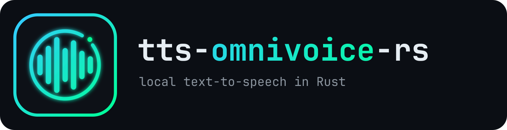

<p align="center">
  
</p>

# tts-omnivoice-rs

This workspace provides two Rust libraries and a small example application for local speech synthesis with OmniVoice. The Rust crates link to a separately compiled OmniVoice C++ shared library. The GGUF models run on an NVIDIA GPU (CUDA), an AMD or Intel GPU (Vulkan, or ROCm for AMD), or the CPU, depending on how that library was built.

| Component | Purpose |
| --- | --- |
| [`xomnivoice/`](xomnivoice/README.md) | Rust wrapper around the OmniVoice C ABI, and the native library build instructions. |
| [`xtts/`](xtts/README.md) | Voice catalog, reference caching, speed and pitch controls, and model download. |
| `xtts_examples/` | Command-line synthesis and an HTTP server example. |
| [`docker-compose/`](docker-compose/README.md) | Containers that build and run the server: one folder per NVIDIA or AMD GPU family, Intel and AMD integrated graphics, and CPU. |

The repository does not distribute the OmniVoice C++ sources, CUDA, or prebuilt native libraries. Linux x86-64 is the only supported platform.

## Quick start

1. **Build and install OmniVoice.** Follow [Install the native library](xomnivoice/README.md#install-the-native-library): build tools, the supported source commit, CMake for CPU or your GPU, then a system-wide installation or `OMNIVOICE_LIB_DIR`.

   To only run the server, [Docker Compose](docker-compose/README.md) does steps 1 and 3 in a container; you still download the models in step 2.

2. **Download the models** into `xtts/models/` as described in [Model files](xtts/README.md#model-files). The voice samples are already in `xtts/samples/`.

3. **Run the server** from this workspace root:

   ```bash
   cargo run --locked -p xtts_examples --bin server
   ```

   In another terminal:

   ```bash
   curl -fsS http://127.0.0.1:8002/health
   curl -fsS http://127.0.0.1:8002/synthesize \
     -H 'Content-Type: application/json' \
     -d '{"id":"32460c45-4bcc-4266-8920-582bbbb4824a","text":"Ciao a tutti!"}' \
     -o speech.wav
   ```

   The [HTTP server section](xtts/README.md#http-server) lists every endpoint and field; [Command-line examples](xtts/README.md#command-line-examples) covers synthesis without a server.

4. **Verify** the whole workspace:

   ```bash
   cargo check --workspace --all-targets --locked
   cargo test --workspace --locked
   cargo test --workspace --locked -- --ignored
   ```

   The last command runs the integration tests that load the models; a GPU is recommended.

## Environment variables

| Variable | Read at | Used by | When unset |
| --- | --- | --- | --- |
| `OMNIVOICE_LIB_DIR` | build | `xomnivoice` | the system-wide library from the `ldconfig` cache; see [4a/4b](xomnivoice/README.md#4a-install-system-wide) |
| `XTTS_MODEL_DIR` | runtime | `Xtts::new` | `xtts/models/` at the path where `xtts` was built |
| `XTTS_DEVICE` | runtime | `Xtts::new` | the best available device; see [devices](#gpu-cpu-and-device-selection) |
| `XTTS_SAMPLES_DIR` | runtime | `server`, `synthesize` | `xtts/samples/` in this workspace |
| `XTTS_BIND` | runtime | `server` | `127.0.0.1:8002` |

With `OMNIVOICE_LIB_DIR`, executables embed that directory at build time: rebuild them after moving it, and export the variable in every new shell.

## GPU, CPU, and device selection

The GPU architecture is fixed when compiling OmniVoice; see [the architecture table](xomnivoice/README.md#1-install-build-tools). A CPU-only build needs no CUDA toolkit.

The device is chosen once, when the model loads. `XTTS_DEVICE` accepts a GGML device name such as `CUDA0` or `CPU`, or a DRM node such as `/dev/dri/renderD129`; a value that matches no device logs a warning and falls back to the best available one. Details are in [device selection](xomnivoice/README.md#device-selection). To force CPU with a CUDA build:

```bash
XTTS_DEVICE=CPU cargo run --locked -p xtts_examples --bin server
```

The startup log then says `LM backend: CPU` and `PipelineCodec ... backend=CPU`. CPU synthesis is much slower: "Ciao a tutti!" took 0.75 s on an RTX 4060 Ti and 19.6 s on a 16-thread Ryzen 9 7950X. The [measured speed table](docker-compose/README.md#measured-speed) compares all tested hardware.

## Security

The example server handles requests sequentially, has no authentication, and binds to loopback by default. Keep it there unless you add access controls.

## License

The Rust code is licensed under the [MIT License](LICENSE). OmniVoice and GGML, built separately, are also MIT-licensed.
